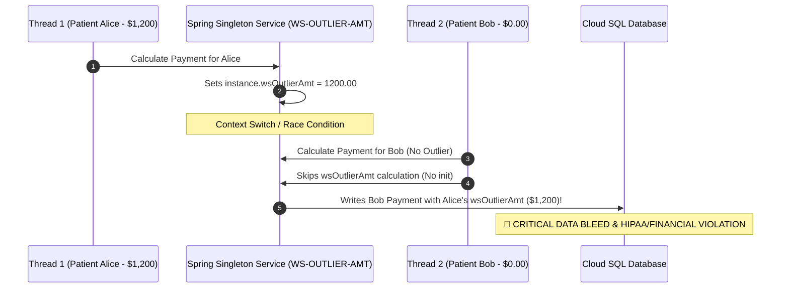

# Module 02: Residual Memory Ghosts & REDEFINES Overlay Traps

> **Category:** High-Risk Architectural Vulnerabilities in Mainframe Modernization  
> **Diagnostic Technology:** CobolIQ Static Memory Manifold Analyzer  
> **Scope:** `WORKING-STORAGE`, `REDEFINES`, `COMP-3` byte layouts & Multi-Thread Concurrency

---

## 1. The Anatomy of a Residual Memory Ghost

In legacy mainframe z/OS runtime execution, `WORKING-STORAGE SECTION` buffers are allocated statically in contiguous RAM address space. When batch processing loops through millions of records, memory addresses are **not automatically zeroed out** unless explicitly cleared via `INITIALIZE` or `MOVE SPACES / ZEROES`.

```cobol
       01  WS-CLAIM-PAYMENT-RECORD.
           05  WS-PROVIDER-ID          PIC X(10).
           05  WS-ESRD-BASE-RATE       PIC 9(5)V99 COMP-3.
           05  WS-OUTLIER-AMOUNT       PIC 9(7)V99 COMP-3.
           05  WS-SPECIAL-RURAL-FLAG   PIC X(01).
```

### The Dormant Flaw on Mainframe:
1. **Record #1 (Rural Hospital Claim):** `WS-SPECIAL-RURAL-FLAG` is set to `'Y'`. Rural multiplier ($1.189$) is applied.
2. **Record #2 (Urban Hospital Claim):** The input transaction has spaces for the rural flag. The developer omitted `INITIALIZE WS-CLAIM-PAYMENT-RECORD` at the top of the processing loop.
3. **The Silent Contamination:** `WS-SPECIAL-RURAL-FLAG` retains the residual byte `'Y'` in RAM from Record #1.
4. **Mainframe Execution:** The urban claim receives an unauthorized $18.9\%$ rural bonus. The job returns `RC=0000` with zero operational alerts.

---

## 2. The REDEFINES Memory Overlay Trap (S0C7 / Data Exception)

COBOL allows distinct variables with different data representations to occupy the exact same physical byte offsets using the `REDEFINES` clause.

```cobol
       01  WS-TRANSACTION-BUFFER.
           05  WS-RAW-FIELD            PIC X(08).
           05  WS-PACKED-AMT REDEFINES WS-RAW-FIELD PIC S9(13)V99 COMP-3.
```

```
Physical Byte Layout (8 Bytes in RAM):
+----+----+----+----+----+----+----+----+
| B0 | B1 | B2 | B3 | B4 | B5 | B6 | B7 |
+----+----+----+----+----+----+----+----+
[ <-------- WS-RAW-FIELD (Alphanumeric PIC X(8)) --------> ]
[ <-------- WS-PACKED-AMT (Packed Decimal COMP-3) -------> ]
```

### The Detonation Mechanics:
1. When a subsystem writes character data (e.g. `'PENDING '` or spaces) into `WS-RAW-FIELD`, the nibbles in RAM no longer conform to valid BCD (Binary Coded Decimal) format (where the last nibble must be `C`, `D`, or `F`).
2. The next arithmetic instruction referencing `WS-PACKED-AMT` (e.g., `ADD WS-PACKED-AMT TO WS-TOTAL`) causes the hardware ALU on z/Architecture to immediately trigger a **`S0C7` Data Exception (ABEND)**.
3. In naive Java/C# transpilation, `REDEFINES` is commonly converted into distinct fields or union classes without byte-exact synchronization, causing silent data divergence or `NumberFormatException`.

---

## 3. The Multi-Threaded Cloud Detonation (The Java Singleton Trap)

When legacy COBOL programs are refactored into modern microservices (e.g., Spring Boot / Java REST APIs), developers frequently map `WORKING-STORAGE` fields as class-level instance variables.



### The CobolIQ Solution: StateFrameBuffer & Pure Functional Isolation
1. **Zero Shared State:** CobolIQ isolates memory into a thread-local, zero-copy `StateFrameBuffer`.
2. **Algebraic Memory Manifold:** Variable mutations are mapped as pure immutable state transitions $S_{n+1} = f(S_n)$, entirely eliminating residual memory ghost contamination.
3. **Deterministic BCD Validation:** All packed decimal accesses are validated at compile-time with zero-overhead bounds checking.

---

*(C) 2026 CobolIQ. Deterministic Memory Diagnostics & Sovereign Runtimes.*
