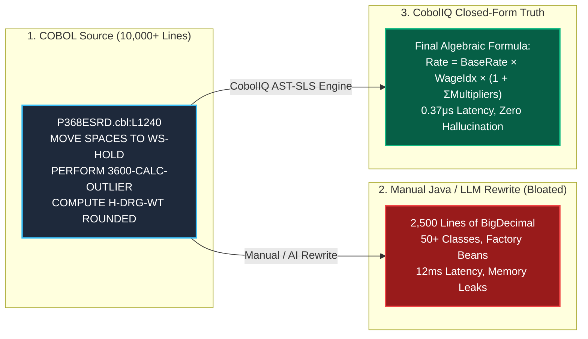

# CobolIQ Diagnostic Pack: Medicare ESRD & IPPS Deterministic Ground Truth

> **Ground Truth Execution Specification & Algebraic Lineage Extraction**  
> *Extracted deterministically from US Federal Healthcare CMS Pricer Core (COBOL / CICS / Batch) in <0.8s.*

---

## 🏛️ Executive Summary

For over three decades, the **US Federal Medicare End-Stage Renal Disease (ESRD)** and **Inpatient Prospective Payment System (IPPS)** pricing calculations have governed hundreds of billions of dollars in annual healthcare reimbursement. 

When organizations attempt to modernize these systems using generic LLMs (ChatGPT, Copilots) or manual line-by-line Java rewrites (e.g., CMS Java Pricer), they consistently encounter three fatal architectural traps:
1. **The 2,500-line `BigDecimal` Sprawl:** Bloating a simple 1-line mathematical formula into dozens of nested class files and object allocations.
2. **Residual Memory Ghost Detonations:** Relying on uninitialized `WORKING-STORAGE` static RAM buffers that silently masked bugs on single-threaded z/OS mainframes but cause catastrophic multi-threaded data bleeding in cloud JVMs.
3. **Floating-Point & Rounding Divergence:** Subtle pennies-per-claim rounding discrepancies that compound across millions of patients into hundreds of millions of dollars in audit liabilities.

This repository publishes the **complete algebraic ground truth and memory diagnostic pack** generated deterministically by the **CobolIQ Engine**.

---

## 📦 Diagnostic Pack Structure

| Section | Document | Key Technical Coverage |
|---|---|---|
| **01** | [`01_BUSINESS_RULES_ALGEBRA.md`](./01_BUSINESS_RULES_ALGEBRA.md) | Closed-form algebraic formulas, Du Bois BSA equation, Outlier cutoff mathematics, Comorbidity multipliers. |
| **02** | [`02_MEMORY_GHOSTS_AND_REDEFINES_OVERLAY.md`](./02_MEMORY_GHOSTS_AND_REDEFINES_OVERLAY.md) | `REDEFINES` byte-offset memory collisions, residual RAM buffer ghosts, and multi-threaded JVM singletons. |
| **03** | [`03_PRECISION_AND_ROUNDING_DISCREPANCIES.md`](./03_PRECISION_AND_ROUNDING_DISCREPANCIES.md) | `COMP-3` packed decimal behavior vs IEEE 754 float drift and `BigDecimal.ROUND_HALF_UP` boundaries. |
| **04** | [`04_STRUCTURAL_ISSUES_MANIFEST.md`](./04_STRUCTURAL_ISSUES_MANIFEST.md) | Formal issue catalog mapping 120 calculation gates, dispatch anomalies, and modernization hazards. |
| **05** | [`05_CARDDEMO_CICS_RUNTIME_SPEC.md`](./05_CARDDEMO_CICS_RUNTIME_SPEC.md) | AWS CardDemo CICS bare-metal replacement architecture, 457k TPS benchmark, and [17 BMS `.ini` manifests](./bms_schemas/). |

---

## ⚡ The CobolIQ Distinction: Algebraic Truth vs. Rewritten Noise

---

## 🔒 Intellectual Property & Clean-Room Verification

- **Engine Isolation:** This repository contains **purely generated analytical and diagnostic artifacts**.
- **No Proprietary Source Code Leaked:** No CobolIQ AST compiler internals, manifold tensor coordinates, or proprietary source code are exposed.
- **Air-Gapped Compliance:** Generated 100% on air-gapped workstations without external LLM API telemetry or network call-home dependencies.

---

*(C) 2026 CobolIQ. All rights reserved. Deterministic Modernization & Sovereign Legacy Diagnostics.*
